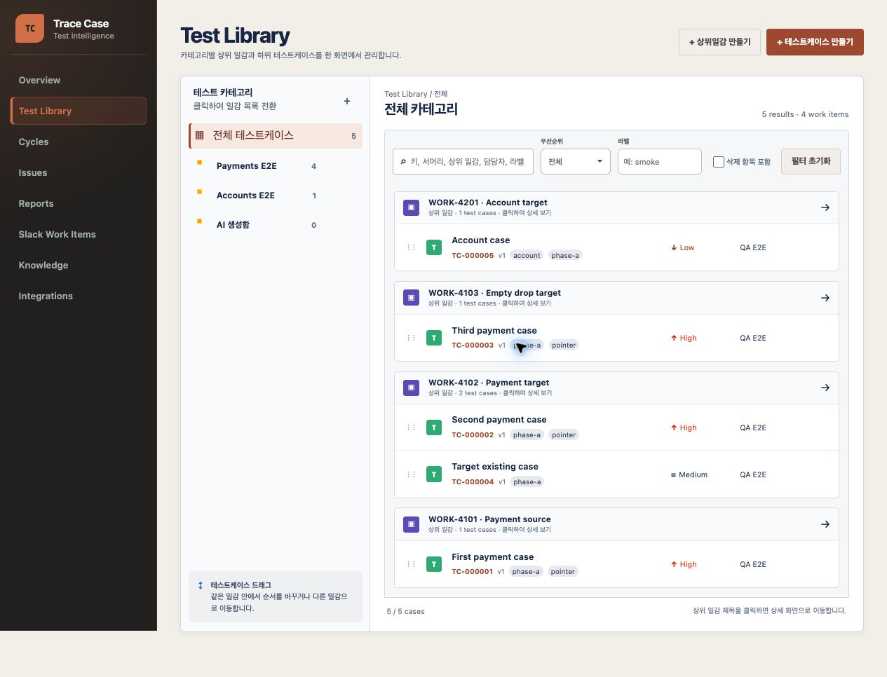
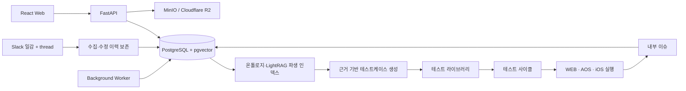

# Trace Case

> Slack 일감과 과거 QA 근거를 연결해 테스트케이스 작성부터 사이클 실행, 이슈 추적까지 한곳에서 관리하는 팀용 QA 워크스페이스

[](https://github.com/kimdol1045-hash/trace-case/actions/workflows/ci.yml)

Trace Case는 Jira·Zephyr의 익숙한 업무 흐름을 바탕으로 만든 단일 팀용 테스트 관리 도구입니다. 도메인과 상위 일감 아래에서 테스트케이스를 관리하고, WEB·AOS·iOS 실행 결과와 내부 이슈를 연결합니다. Slack 일감과 thread의 결정사항, 기존 테스트·실행·이슈 이력은 출처가 보존된 지식으로 축적되며 자동 생성 시 검색 근거로 재사용됩니다.

- 단일 워크스페이스, 로그인·승인 절차 없음
- Jira 연동 없이 테스트케이스·사이클·이슈를 내부 원장으로 관리
- 자동 생성 provider는 기본 비활성화이며 수동 생성이 기본 흐름
- 운영 배포는 사내망 또는 VPN을 전제로 설계



## 핵심 기능

| 영역 | 제공 기능 |
|---|---|
| 테스트 라이브러리 | 카테고리·상위 일감·테스트케이스 구조, 검색과 필터, drag 이동·재정렬, 버전 이력, 삭제·복원 |
| 테스트케이스 | 서머리, 라벨, 우선순위, 담당자와 `사전조건 → 테스트 동작 → 기대 결과` 스텝 편집 |
| 테스트 사이클 | 상위 일감 또는 복수 라벨로 실행 범위 구성, 스냅샷 고정, 미진행·진행 중·완료 상태 관리 |
| 테스트 실행 | 스텝별 WEB·AOS·iOS PASS·FAIL·BLOCKED 기록, 자동 저장, 비고와 통합 결과 집계 |
| 내부 이슈 | 실행 중 이슈 생성·자동 연결, 심각도·상태·재현 정보·댓글·변경 이력·다중 첨부파일 관리 |
| Slack 수집 | allowlist 채널의 일감과 thread, 수정 이력, 동기화·재시도 상태를 원문 근거로 보존 |
| 지식·자동 생성 | PostgreSQL 원장, pgvector와 LightRAG 파생 인덱스, 근거 기반 생성·비교·적용·품질 검토 |
| 대시보드·리포트 | 사이클·상위 일감·플랫폼·이슈 상태를 실제 원장 집계로 시각화 |
| 첨부파일 | 로컬 MinIO 또는 비공개 Cloudflare R2 직접 업로드, ClamAV 검사, 이미지·텍스트 미리보기 |

## 동작 구조



PostgreSQL이 테스트 자산과 이력의 유일한 원장입니다. LightRAG와 vector 검색은 재구축 가능한 파생 계층이며, 생성 결과가 원장에 자동 확정되지는 않습니다. 첨부파일은 비공개 object storage에 보관하고 메타데이터와 연결 이력만 PostgreSQL에서 관리합니다.

## 기술 구성

- Web: React 19, TypeScript, Vite, React Router
- API: FastAPI, Pydantic, SQLAlchemy, Alembic
- Worker: PostgreSQL `SKIP LOCKED` 기반 background job, transactional outbox
- Data: PostgreSQL 16, pgvector, LightRAG
- Storage: Cloudflare R2 호환 S3 API, 로컬 MinIO, ClamAV
- Quality: Vitest, Pytest, Playwright, ESLint, Ruff, mypy
- Workspace: pnpm monorepo, Docker Compose, GitHub Actions

## 처음 한 번 준비

필수 도구는 Node.js 22+, pnpm 10+, Python 3.12+, Docker입니다.

```bash
git clone https://github.com/kimdol1045-hash/trace-case.git
cd trace-case
python3 -m venv .venv
pnpm run setup
```

외부 연동 없이 로컬 기능을 확인할 때는 별도의 credential이 필요하지 않습니다. Slack, R2, LightRAG 또는 생성 provider를 연결할 때만 [`backend/.env.example`](./backend/.env.example)의 관련 설정을 승인된 secret store나 실행 환경에 주입합니다. 실제 secret을 저장소나 검증 증적에 기록하지 마세요.

## Web + API + Worker 개발 모드

다음 명령은 PostgreSQL 16 + pgvector, private MinIO, ClamAV를 시작하고 migration을 적용한 뒤 Web, API, Worker를 함께 실행합니다.

```bash
pnpm dev
```

| 서비스 | 주소 |
|---|---|
| Web | <http://localhost:5173> |
| API health | <http://localhost:8000/api/health> |
| API readiness | <http://localhost:8000/api/ready> |
| OpenAPI | <http://localhost:8000/docs> |

`Ctrl-C`로 세 애플리케이션 프로세스를 함께 종료할 수 있습니다. PostgreSQL과 object storage volume은 유지되며, 로컬 컨테이너만 내리려면 `pnpm infra:down`을 실행합니다. 이미 준비된 DB를 사용할 때는 `TC_DATABASE_URL`을 지정하고 `pnpm dev:apps`를 사용합니다.

## 주요 화면

| 경로 | 설명 |
|---|---|
| `/` | Overview 대시보드 |
| `/test-cases` | 카테고리·상위 일감 기반 테스트 라이브러리 |
| `/test-cases/new` | 수동 테스트케이스 생성 |
| `/cycles` | 사이클 목록, 상태 필터, 삭제·복원 |
| `/cycles/:cycleId/execute` | 스텝별 플랫폼 실행 워크스페이스 |
| `/issues` | 내부 이슈 목록과 상태 필터 |
| `/reports` | 사이클·실행·이슈 분석 |
| `/slack-work-items` | Slack 일감 원문, thread, 동기화 상태 |
| `/generation/failures` | 자동 생성 실패와 안전한 재시도 경계 |
| `/generation/quality-review` | 생성 품질 후보 검토 |
| `/knowledge` | 근거와 관계를 포함한 QA 지식 검색 |
| `/integrations` | Slack, object storage, generation 연결 상태 |

상세 화면과 생성 화면을 포함한 실제 사용 순서는 [사용 가이드](./docs/user-guide.md)를 참고하세요.

## 공통 검사와 생성 명령

```bash
pnpm check                         # lint + typecheck + unit + 계약/ADR/운영/OpenAPI 검사
pnpm --filter @tc/web build        # Web production build
pnpm test:migration                # 전용 disposable test DB에서 migration 검사
pnpm test:phase-f                  # Phase F 회귀와 브라우저 UAT harness 검사
pnpm phase-f:uat:browser:preview   # 로컬 격리 UAT 실행 계획 미리보기
pnpm openapi:generate              # OpenAPI와 TypeScript client 동시 갱신
pnpm openapi:check                 # 생성 산출물 drift 검사
```

`test:migration`은 Alembic을 `base`까지 내렸다가 다시 올립니다. 데이터베이스 이름에 반드시 `test`가 포함된 전용 DB만 사용해야 하며, 공유·운영 DB에는 실행하면 안 됩니다. 자세한 절차는 [backend 안내](./backend/README.md)를 따릅니다.

OpenAPI 변경은 FastAPI 모델에서 시작합니다. 변경 후 `pnpm openapi:generate`를 실행하고 `packages/api-client/openapi.json`과 생성된 TypeScript schema를 같은 커밋에 포함해야 합니다.

## 저장소 구조

```text
apps/
  web/                 React 사용자 화면
  api/                 FastAPI HTTP API
  worker/              background job·outbox worker
backend/               공통 Python 도메인·repository·migration
packages/
  api-client/          OpenAPI 기반 TypeScript client
  contracts/           JSON Schema와 상태 계약의 원본
  ui/                  공통 UI component
deploy/                로컬 인프라와 운영 runbook
docs/                  기획, 개발 명세, ADR, 단계별 검증 보고서
evals/                 Slack·지식·자동 생성 평가 fixture
scripts/               검증, import, 평가, 복구·UAT 도구
```

## 검증 상태

현재 코드 기준 로컬 격리 physical-browser 자동 UAT는 데스크톱과 390px 모바일에서 통과했습니다.

- 15/15 workflow, 37/37 assertion 통과
- 실제 Vite, FastAPI, Worker, PostgreSQL 16, MinIO, ClamAV 사용
- 테스트케이스 작성·이동·버전, 사이클 실행, 이슈·첨부파일, dashboard/report 집계 검증
- 종료 후 disposable DB·bucket·container·volume·network 정리 검증

다만 이 결과는 운영 배포 완료를 의미하지 않습니다. 실제 Cloudflare R2, Slack workspace, 외부 생성 provider, 배포된 HTTPS origin, 담당 QA의 수동 판정과 production release gate는 아직 별도 검증이 필요합니다. 상세 증거는 [Wave 10 검증 보고서](./docs/phase-f/sprint-f1-wave10-verification.md)와 [독립 재검증 보고서](./docs/phase-f/sprint-f1-wave10-second-independent-verification.md)에 있습니다.

GitHub Actions는 다음 두 job을 실행합니다.

- `quality`: lint, typecheck, unit test, schema·ADR·runbook·OpenAPI drift, Web build
- `migration`: PostgreSQL 16 + pgvector migration, repository·동시성 검사

브랜치 보호를 적용할 때 두 job을 required status check로 지정해야 합니다.

## 외부 연동과 운영

모든 외부 연동은 기본 비활성화이며 각각 독립적으로 켭니다.

- [Slack 설치·수집 runbook](./deploy/slack/README.md)
- [Cloudflare R2·MinIO·ClamAV runbook](./deploy/object-storage/README.md)
- [지식 projection·LightRAG runbook](./deploy/knowledge/README.md)
- [자동 생성 provider runbook](./deploy/generation/README.md)
- [통합 운영 runbook](./deploy/operations/README.md)

운영 환경에서는 API와 Web을 사내망 또는 VPN에 두고 Slack ingress만 별도 public listener로 분리합니다. wildcard CORS, public bucket, 저장소 내 credential, 운영 데이터에 대한 rehearsal 실행은 허용하지 않습니다.

## 문서

- [제품 기획서](./docs/test-management-product-plan.md)
- [개발 명세](./docs/test-management-development-spec.md)
- [페이즈·스프린트·태스크 로드맵](./docs/test-management-roadmap.md)
- [화면별 사용 가이드](./docs/user-guide.md)
- [화면 네비게이션 정책](./docs/ui-navigation-policy.md)
- [Architecture Decision Records](./docs/adr/README.md)

변경 전에는 관련 ADR과 계약을 확인하고, 변경 후 `pnpm check`와 Web production build가 모두 통과한 상태로 커밋합니다.
